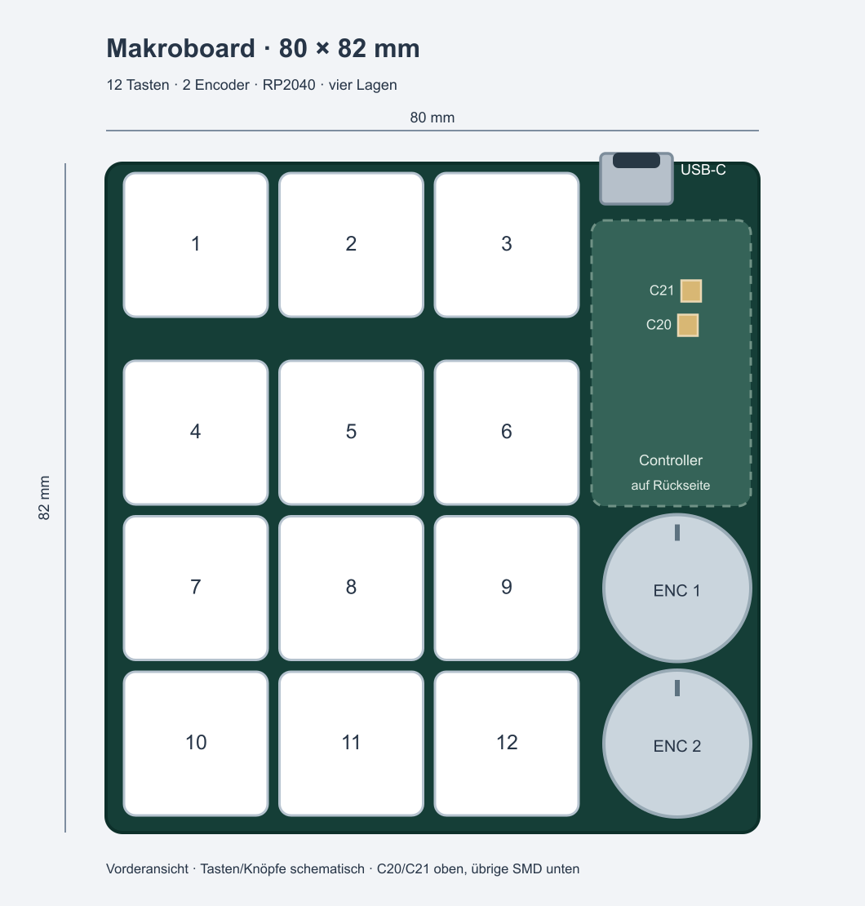

# Makroboard – USB-C an der Oberkante

**80 × 82 mm, vier Lagen, nominell 1,0 mm.** Gegenüber der vorherigen Version mit 80 × 122 mm ist die Fläche um **32,8 %** kleiner. Revision TOP-USB vom 17.10.2026, KiCad 10. Die Abmessungen der vorherigen kompakten Version bleiben erhalten.

Die zwölf Tasten stehen in drei Spalten mit 19,05 mm Abstand: oben eine Dreierreihe, darunter der 3×3-Block. Der Abstand zwischen oberer Reihe und Block beträgt 23 mm. Die beiden Encoder sitzen jetzt **rechts unten** übereinander, auf Höhe der unteren zwei Tastenreihen. USB-C sitzt **direkt an der Oberkante**, rechts neben der oberen Tastenreihe. Der Controllerbereich liegt darunter rechts oben. Die empfindlichen internen Verbindungen wurden als zusammenhängende Gruppe gedreht und erhalten; Matrix, Encoder und LED-Kette wurden neu verdrahtet. Die Zeichnung zeigt beispielhafte 17,6-mm-Tastenkappen und 18-mm-Knöpfe; Gehäuse und tatsächlich gewählte Bedienteile separat mechanisch abstimmen.

## Bestückung

**67 SMD-/Hybrid-Bauteile liegen unten, nur C20 und C21 oben.** Diese beiden zwingend benötigten 100-nF-Kondensatoren liegen direkt gegenüber den DVDD-Pins des RP2040 und sind für Handlöten als **0805** ausgeführt. Die Verbindungslängen betragen einschließlich des Seitenwechsels etwa 3,6 und 3,2 mm. Sie wegzulassen wäre elektrisch falsch.

Zwei getrennte Bestückungsvarianten sind vorbereitet; **genau eine** wählen:

| Variante | Fabrik | Handlöten |
|---|---|---|
| `assembly/pcbway-one-side/` | 67 Bauteile, ausschließlich Bottom | C20 + C21 auf Top, zusätzlich Tasten/Encoder |
| `assembly/pcbway-all-smd/` | 69 Bauteile: 67 Bottom + 2 Top | Tasten/Encoder |

Bei einseitiger Fabrikbestückung enthält `assembly/MANUAL-SMD-PARTS.csv` die beiden zusätzlichen Kondensatoren: Yageo **CC0805KRX7R9BB104**, LCSC **C49678**, 100 nF, 50 V, X7R, 10 %. Gleicher Typ wie die bereits verwendeten 0805-Kondensatoren. R3 bleibt DNP. J2 ist ein optionaler BOOT-Header; Testpads werden nicht eingekauft. Die vollständigen JLCPCB-Dateien unter `assembly/` enthalten **alle 69** SMD-/Hybrid-Bauteile.

Für PCBWay gehören jeweils BOM, CPL und die Bestückungshinweise aus demselben Variantenordner zusammen. Gerber, Bohrdaten und `FABRICATION-NOTES.txt` sind für beide Varianten identisch. Die einseitige Variante benötigt nur eine Bottom-Pastenschablone; C20/C21 werden anschließend von Hand gelötet. Positionswinkel stammen unverändert aus KiCad; der Bestücker muss seine Maschinenbibliothek und Pin-1-Ausrichtungen im CAM abgleichen. Lagerbestand und aktuelles Angebot wurden nicht neu bestätigt.

## Projekt und Firmware

`makroboard.kicad_pro` öffnen. Die lokalen Symbol- und Footprint-Bibliotheken sind enthalten. Die **GPIO-Belegung ist gegenüber der vorherigen kompakten 80×82-mm-Version unverändert**; `firmware-pinmap.csv` enthält die vollständige aktuelle Zuordnung. Die Schaltpläne werden elektrisch unverändert mitgeliefert und gegen die neue PCB geprüft.

Die LED-Kette beginnt jetzt bei **D1 unter SW3 rechts oben** und läuft schlangenförmig nach unten: SW3 → SW2 → SW1 → SW4 → SW5 → SW6 → SW9 → SW8 → SW7 → SW10 → SW11 → SW12. `led-key-map.csv` enthält die LED-Indizes. Die Zuordnung der LED-Farben in der Firmware/App entsprechend anpassen. D1 liegt damit nahe am Controller und seinem Pegelwandler.

Die USB-Hauptstrecken vom ESD-Schutz zu den Serienwiderständen messen jetzt rund **27 / 28 mm statt 45 / 45 mm**. Die Verbindungslängen der Versorgungskondensatoren, Flash-Anbindung und Quarzschaltung bleiben erhalten. Die Bauteilauswahl einschließlich der zwei Top-Kondensatoren in 0805 bleibt gleich. Neue BOM/CPL und Gerber verwenden: Die früheren Positionen passen nicht mehr.

## Controller und Prüfstand

Die lokalen Versorgungskondensatoren, Flash-/BOOT-Anbindung, Quarzbereich, USB-Widerstände und Masseführung wurden erneut anhand des [RP2040 Hardware Guide](https://datasheets.raspberrypi.com/rp2040/hardware-design-with-rp2040.pdf) kontrolliert. Alle Vias liegen außerhalb der Lötpads und sind auf beiden Seiten mit Lötstopp abgedeckt. Das RP2040-Massepad ist geschlossen; Resin-Füllung und Kupferkappen sind für dieses Layout nicht vorgesehen.

Ergebnisse und Messwerte stehen in `PRUEFBERICHT.md` und `checks/`. Das ist ein am Rechner geprüfter Entwurf, **kein erprobter Prototyp**. Die USB-Impedanz muss der Hersteller für seinen tatsächlichen vierlagigen 1-mm-Aufbau bestätigen; Einzelheiten stehen in `FABRICATION-NOTES.txt`. Nicht einfach einen anderen Standard-Lagenaufbau bestellen.

## Dateien

- `*.kicad_pro`, `*.kicad_sch`, `*.kicad_pcb`, `lib/`, Bibliothekstabellen: editierbares Projekt.
- `gerbers/`: vier Kupferlagen, Lötstopp, Bestückungsdruck, Paste, Kontur und getrennte PTH-/NPTH-Bohrdaten.
- `assembly/`: getrennte PCBWay-Varianten, vollständige JLCPCB-Dateien, Roh-Positionsexport und Bauteilauswahl.
- `preview/`: 3D-Ansichten, Bestückungszeichnungen und schematische Bedienteilanordnung.
- `checks/`: elektrische und geometrische Prüfergebnisse, Netlist, Leitungslängen und Exportprotokoll.
- `SHA256SUMS.txt`: Zuordnung aller Lieferdateien zu dieser Revision.

## Erstes Einschalten

Nach Bestückung einschließlich C20/C21 auf Lötbrücken prüfen. Beim ersten Einschalten Stromaufnahme beobachten und +3V3 sowie +1V1 kontrollieren. Für den ROM-USB-Bootloader J2 Pin 1 mit GND verbinden, RUN an TP3 kurz auf GND ziehen und wieder lösen; anschließend BOOT lösen. `RPI-RP2` sollte erscheinen. Alternativ über SWD programmieren: TP1 SWCLK, TP2 SWDIO, TP3 RUN, TP4 GND, TP5 3,3-V-Referenz. LEDs zunächst mit geringer Helligkeit testen; die Hinweise zur gewählten SK6812MINI-E-Variante in der BOM beachten.
